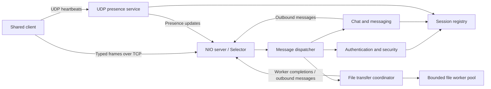

# NetSync architecture

Status: finalized technical foundation; no networking features are implemented by these documents. Wire rules are in [protocol.md](protocol.md); ownership and acceptance scenarios are in [member-tasks.md](member-tasks.md).

## Overall design

Use one central Java NIO TCP server for login, chat, and file-transfer messages. Its single Selector event loop owns the ServerSocketChannel, all accepted SocketChannels, per-connection ByteBuffers, frame decoding, and outgoing queues. The chat and transfer modules must not open additional TCP listeners or read/write these channels directly. A shared client connects to this server.

A separate UDP presence service runs in the same server process, with its own DatagramChannel and small receive/scheduling loop. It tracks heartbeats but does not authenticate users independently. TCP disconnection ends a session; a UDP timeout marks presence `OFFLINE` after 15 seconds without closing a healthy TCP connection. This avoids treating UDP packet loss as a logout.

## Responsibilities and package boundaries

| Package | Owner and boundary |
| --- | --- |
| `com.netsync.server` | Member 1: TCP listener, Selector, framing, dispatch, bounded output queues, connection cleanup and lifecycle wiring. |
| `com.netsync.chat` | Member 2: validate chat content, resolve recipients through sessions, route messages, acknowledge or reject requests. No channel ownership. |
| `com.netsync.presence` | Member 3: UDP receive/send, heartbeat validation, expiry and online/offline transitions; optional discovery only after approval. |
| `com.netsync.security` | Member 4: identity validation, session creation/revocation, permission checks and presence credentials. |
| `com.netsync.transfer` | Member 5: transfer state, consent, safe storage, chunk coordination and bounded file I/O workers. |
| `com.netsync.common` | Shared protocol model, message types, error codes, codec interface and configuration constants. Assign each shared change a reviewer. |
| `com.netsync.client` | Shared minimal CLI client and matching framing; each member contributes commands for their feature. Member 1 coordinates integration. |

## Shared integration contracts

The following names describe proposed Java contracts, not existing classes:

- `MessageEnvelope`: version, type, message ID, optional reply ID and typed body. `MessageCodec` uses Jackson 2.21.8 for strict UTF-8 JSON controls (kind `0x01`). `FileChunk` carries message UUID, transfer UUID, sequence and immutable raw bytes (kind `0x02`); it bypasses JSON. The common `FrameCodec` defines both layouts; the server transport owns prefix/kind decoding and partial I/O. Exact byte limits are in protocol.md.
- `ConnectionContext`: server-generated connection ID and optional authenticated session reference. Handlers receive this context; they never trust a sender identity from a request body.
- `MessageHandler.handle(context, message)`: invoked by the dispatcher on the Selector thread. Handlers do bounded validation and state transitions only; no blocking disk operations or credential derivation on this thread.
- `OutboundSink.send(connectionId, outboundFrame)`: accepts a JSON envelope or binary chunk with an explicit accepted/rejected result. On the Selector thread it validates and enqueues directly. Other threads submit a bounded task through `SelectorTasks.submit(task)` and wake the Selector; enqueue acceptance is reported asynchronously after that task runs, never by blocking a worker or the Selector. Only that thread changes interest operations or writes TCP bytes. Acceptance means queued, not delivered.
- `SessionRegistry`: security-owned, thread-safe lookup of session, client ID, connection ID and active state. TCP disconnect/logout invalidates the session, presence token and pending transfers. Other modules use its API, not mutable internal maps.
- `AuthorizationService`: security-owned checks for authenticated operations and transfer participants. Presence validation also uses security-owned credential checks.
- `PresenceListener.onPresenceChanged(clientId, state)`: presence enqueues an event; the dispatcher publishes `PRESENCE_UPDATE` to authenticated clients. No callback writes a socket directly.
- `TransferCoordinator`: transfer owner accepts control/chunk requests and posts worker results back as Selector tasks. Transfer state belongs to the Selector thread; workers operate on assigned file tasks and return immutable results.

Keep chat and transfer coordination state on the Selector thread. Presence owns its heartbeat timestamps; the session registry is the narrowly shared synchronized state. Worker callbacks must recheck that a session/transfer is still active before sending results. Configure bounded request tasks, output queues and worker tasks; reject overload instead of growing memory indefinitely. Protocol limits and overload behavior are specified in protocol.md.

## Startup and shutdown

1. Validate ports, limits, demonstration security mode and the runtime storage root `data/uploads/` (excluded from Git). Fail startup if required configuration is invalid.
2. Create security/session services, bounded workers, handlers and dispatcher; wire the outbound sink and presence listener.
3. Bind TCP, then UDP; start loops only when both bindings succeed. If either fails, close already opened resources and stop workers.
4. On shutdown, stop accepting new clients/transfers, stop UDP reception and signal the Selector with `wakeup()`.
5. Allow up to five seconds for queued responses and in-flight file tasks to finish. Then close connections, revoke sessions, cancel remaining work and delete incomplete transfer temporary files. Workers use cooperative cancellation and bounded I/O tasks.
6. Close channels and Selector in `finally` paths, shut down workers, and wait for bounded termination. Reuse the same idempotent cleanup path for startup failure and the shutdown hook. Never log passwords or presence tokens.

## Integration approach

Build one end-to-end slice at a time: framing and CLI echo fixture; login/session cleanup; direct chat; UDP presence; consent-based file chunks. Use fake handler/sink/session implementations to develop independently, then integrate against the single dispatcher. Keep fixtures in tests, not extra production TCP servers.

Use the finalized envelopes, limits, contracts and thread ownership below. Each member supplies unit tests plus one integrated scenario from member-tasks.md. Integrate small changes frequently; compile after each integration. Jackson databind 2.21.8 is selected and pinned in the POM; no codec or feature implementation exists yet. For the initial deadline, defer persistence, GUI, rooms, offline delivery, resumable transfers and automatic LAN discovery.

## Final defaults and remaining coordination

TCP 5050 and UDP 5051 bind to `127.0.0.1` by default. Use manual addressing, direct messaging, ephemeral sessions, unique active usernames and local dummy identities. Heartbeats run every 5 seconds and mark presence `OFFLINE` after 15 seconds (checked once per second), without revoking TCP authentication. Both JSON controls (up to 65,536 UTF-8 bytes) and binary chunks (up to 16,384 raw bytes) share the four-byte big-endian length plus one-byte kind framing. Files are limited to 10 MiB, one active transfer per client, 10 server-wide, with stop-and-wait chunk ACKs and storage under `data/uploads/`.

Localhost-only authentication demonstration is the selected baseline and provides no transport confidentiality. Real/network credentials require implemented, verified TLS with certificate validation; current UDP bearer tokens remain loopback-only even with TCP TLS. TLS/DTLS are future scope, not completed features.

The earlier Base64-in-JSON chunk design is replaced by explicit binary frame kinds; the earlier `AWAY` state is replaced by advisory `OFFLINE`. The common protocol is owned jointly: member 1 coordinates, and all five review wire/schema changes. Remaining coordination is assigning actual member names, provisioning disposable dummy identities and reviewing future protocol changes. Selected defaults no longer await approval. GUI, persistence, rooms, resume and discovery remain deferred.
